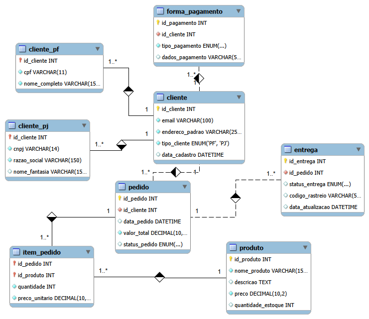

# 🛒 Desafio de Modelagem de Banco de Dados: E-commerce

Este repositório contém a resolução do desafio de modelagem de banco de dados para um cenário de E-commerce, desenvolvido como parte da formação em Tecnologia em Banco de Dados. O objetivo principal foi refinar um esquema conceitual inicial, aplicando regras de negócio essenciais para o varejo digital.

## 📌 Descrição do Projeto

O projeto consiste na criação de um Diagrama Entidade-Relacionamento (DER) — construído utilizando **MySQL Workbench** — contemplando a definição correta de Chaves Primárias (PKs) e Chaves Estrangeiras (FKs). O modelo foi pensado para ser escalável e representar fielmente as operações de uma loja virtual (inspirado no contexto da ZaptUtil).

## 🎯 Regras de Negócio Implementadas (Refinamento)

Durante a modelagem, as seguintes premissas foram rigorosamente aplicadas:

1. **Cliente PJ e PF (Especialização Exclusiva):** 
   - A arquitetura garante que uma conta seja categorizada como Pessoa Física (PF) ou Pessoa Jurídica (PJ). Foi utilizada a técnica de especialização de tabelas (`Cliente_PF` e `Cliente_PJ` herdando da tabela genérica `Cliente`).
   
2. **Múltiplas Formas de Pagamento:**
   - Um cliente pode ter diversas formas de pagamento vinculadas à sua conta. Para isso, foi criada a entidade `Forma_Pagamento` com relação de 1:N com a tabela `Cliente`.

3. **Gestão de Entregas:**
   - Para o rastreamento logístico, foi criada a entidade `Entrega` vinculada à entidade `Pedido` (Relação 1:1). Esta tabela possui atributos específicos para `status_entrega` e `codigo_rastreio`.

## 🛠️ Estrutura do Repositório

* **`diagrama-ecommerce.png`**: Visualização do Diagrama Entidade-Relacionamento (EER).
* **`ecommerce_script.sql`**: Script DDL com a criação do banco de dados, tabelas e constraints.
* **`inserts_dados.sql`**: Script DML com dados fictícios para popular as tabelas e permitir testes.
* **`queries_analise.sql`**: Consultas SQL avançadas (DQL) com métricas de negócio (Faturamento, Curva ABC, Retenção).

## 🗄️ Diagrama Entidade-Relacionamento

